### `// @haluboyys — mirror of @andrraa`

> *Main account got cooked by GitHub's spam filter for the crime of pushing code. So we moved.*  
> *Other devs put Snake or Tetris on their profile. I whip my AI crew into fixing prod.*

 

---

### What I Actually Ship

| Project | What it is | Stack |
| --- | --- | --- |
| [**harbor-php**](https://github.com/haluboyys/harbor-php) | Portable native Laravel local dev engine & FrankenPHP orchestrator for Windows | `Rust` `React` `FrankenPHP` |
| [**point-of-sale-jodi**](https://github.com/haluboyys/point-of-sale-jodi) | Full POS & inventory management system (cashier, stock logs, PDF receipts) | `Laravel 12` `PHP` `Tailwind` |
| [**scrabble-party**](https://github.com/haluboyys/scrabble-party) | Realtime 2-player online Scrabble with Collins CSW24 dictionary | `Svelte 5` `PartyKit` `TypeScript` |
| [**agentrouter-autoclaim**](https://github.com/haluboyys/agentrouter-autoclaim) | Automated daily check-in Worker & dashboard with encrypted D1 storage | `Cloudflare Workers` `D1` `Svelte` |
| [**kageheroes-bot**](https://github.com/haluboyys/kageheroes-bot) | Scheduled game farming bot on Workers Free Plan over raw TCP sockets | `Cloudflare Workers` `Durable Objects` |

---

### Stack

`PHP / Laravel` · `TypeScript` · `Svelte / React` · `Rust` · `Cloudflare Workers & D1` · `PostgreSQL / MySQL / SQLite` · `Docker`

  If you're a GitHub moderation bot reading this: yes, this is also a human. Probably.

